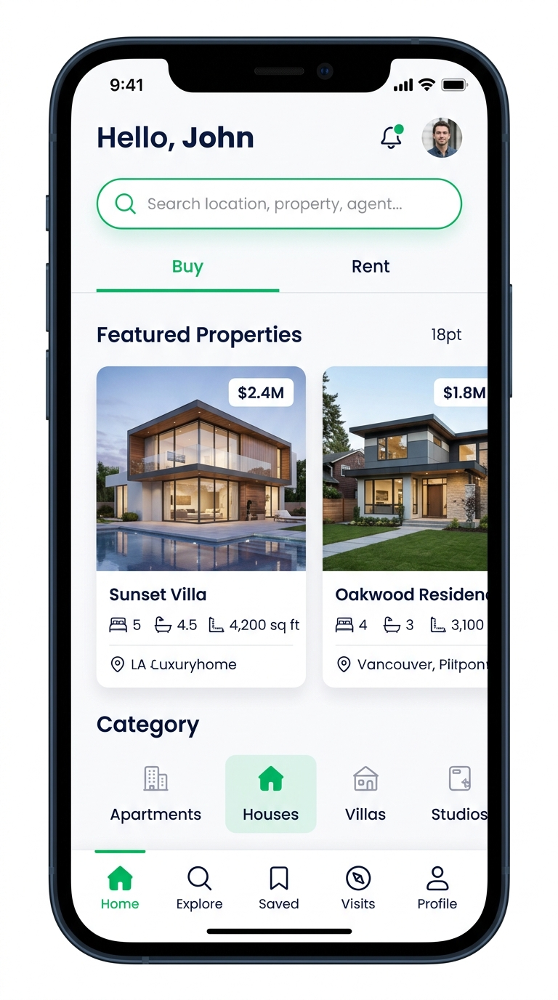
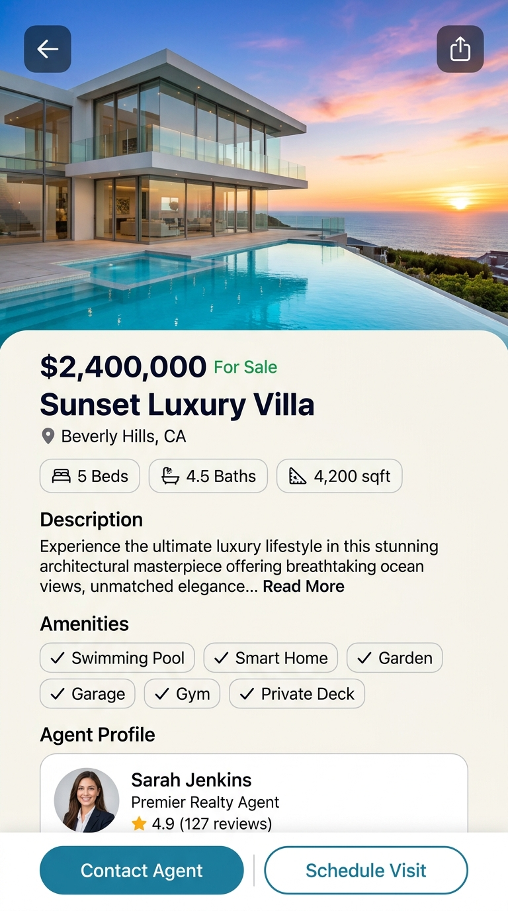
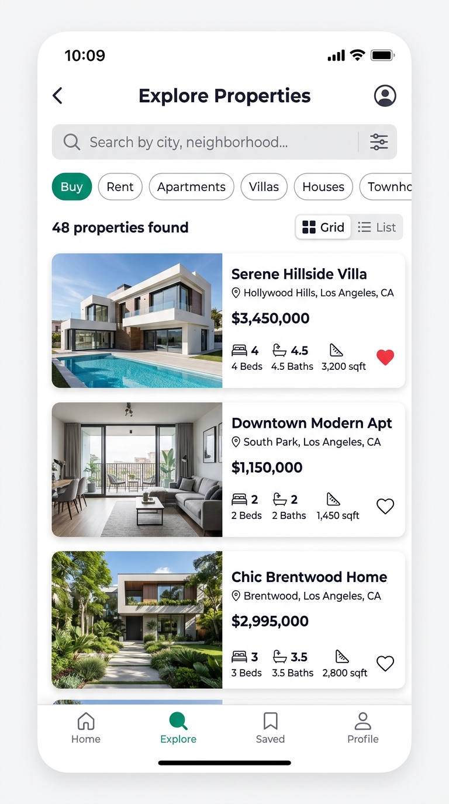
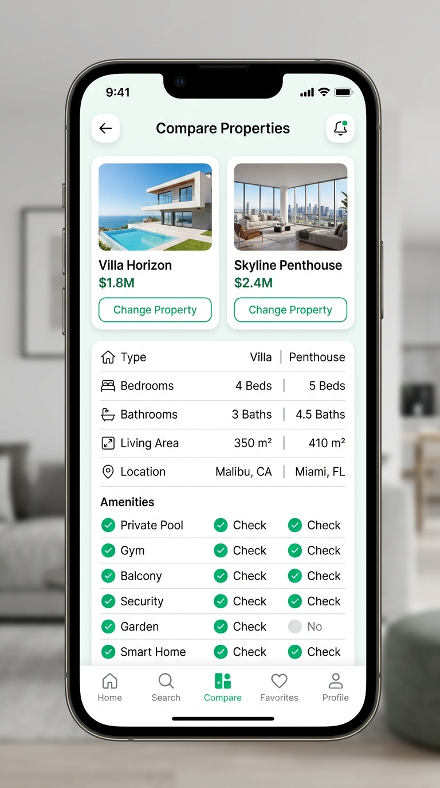

# 🏡 EstateEase

<p align="center">
  <strong>The Modern, Seamless Mobile Platform for Real Estate Discovery & Tour Booking</strong>
</p>

<p align="center">
  
  
  
  
  
</p>

---

## 📱 App Preview & Design Showcase

<table>
  <tr>
    <td align="center" width="25%">
      
      <br />
      <sub><b>🏠 Home Feed</b></sub>
    </td>
    <td align="center" width="25%">
      
      <br />
      <sub><b>✨ Property Details</b></sub>
    </td>
    <td align="center" width="25%">
      
      <br />
      <sub><b>🔍 Search & Explore</b></sub>
    </td>
    <td align="center" width="25%">
      
      <br />
      <sub><b>⚖️ Property Comparison</b></sub>
    </td>
  </tr>
</table>

---

## 🚀 Key Highlights & Features

### 🌟 1. Visual Discovery & Smart Feed
- **Dynamic Property Carousels**: High-resolution photography showcasing luxury villas, modern apartments, and cozy townhomes.
- **Listing Filters**: Instant toggle between **Buy** and **Rent** modes with category filtering.
- **Quick-Access Shortcuts**: Immediate navigation to Saved, Visits, Recently Viewed, and Property Comparison tools.

### 🔍 2. Explore & Real-Time Search
- **Instant Search**: Filter properties by city, neighborhood, or title.
- **View Toggle**: Switch between clean **Card List** view and space-efficient **Grid** view.
- **Comprehensive Spec Badges**: Live metrics for bedrooms, bathrooms, and square footage.

### ⚖️ 3. Side-by-Side Comparison Engine
- Select any two properties in real time to compare:
  - Price & Currency
  - Architectural Property Type & Listing Category
  - Bed / Bath / Area breakdowns
  - Neighborhood & Availability Status
  - Amenities checklist with verified visual indicators

### 📅 4. Visit Scheduling & Tour Manager
- Book upcoming property visits with a date and time slot selector.
- Complete schedule management: view upcoming visits, track past tours, and cancel appointments with immediate state updates.

### 👤 5. Agent Directory & Direct Inquiries
- Verified agent profiles with rating badges, review counts, and listed inventories.
- Direct contact integrations: quick email, phone call dialer, and built-in inquiry message composer.

### 💾 6. Offline-First State & Persistence
- Favorites, visit appointments, profile data, and recently viewed cache are stored locally with `@react-native-async-storage/async-storage`.
- One-click **Clear All Data** setting for easy testing and privacy control.

### 🎨 7. Native Vector Iconography
- Replaced raw emojis with clean, native vector icons powered by `@expo/vector-icons` (`Ionicons`), ensuring consistent cross-platform aesthetics on iOS and Android.

---

## 🛠️ Technology Stack

| Layer | Technology |
|---|---|
| **Framework** | [React Native 0.88](https://reactnative.dev/) with [Expo SDK 58](https://docs.expo.dev/) |
| **Language** | [TypeScript](https://www.typescriptlang.org/) (Strict type safety) |
| **Navigation** | [React Navigation v7](https://reactnavigation.org/) (Native Stack + Bottom Tabs) |
| **Icons** | [@expo/vector-icons](https://icons.expo.fyi/) (Ionicons) |
| **Persistence** | [@react-native-async-storage/async-storage](https://react-native-async-storage.github.io/async-storage/) |
| **UI Components** | Safe Area Context, Reanimated, Linear Gradient |

---

## 📁 Project Architecture

```
EstateEase/
├── assets/                 # App icons, splash screens, and static images
├── docs/
│   └── screenshots/        # High-resolution design mockups for README
├── src/
│   ├── components/
│   │   ├── common/         # PrimaryButton, EmptyState
│   │   └── property/       # PropertyCard with vector icons & badges
│   ├── data/               # Mock data (properties, agents, notifications)
│   ├── navigation/         # AppNavigator (Tabs + Stack routing)
│   ├── screens/
│   │   ├── agent/          # AgentProfileScreen, ContactAgentScreen
│   │   ├── auth/           # SplashScreen
│   │   ├── compare/        # CompareScreen (Side-by-side spec comparison)
│   │   ├── explore/        # ExploreScreen (Search, filters & grid toggle)
│   │   ├── home/           # HomeScreen (Featured, categories & feed)
│   │   ├── notifications/  # NotificationsScreen
│   │   ├── onboarding/     # OnboardingScreen (Interactive walk-through)
│   │   ├── profile/        # ProfileScreen, AboutScreen, PrivacyScreen
│   │   ├── property/       # PropertyDetailScreen
│   │   ├── recent/         # RecentlyViewedScreen
│   │   └── visits/         # VisitsScreen, ScheduleVisitScreen
│   ├── store/              # AppContext (AsyncStorage global state)
│   ├── theme/              # Color tokens, spacing, typography, and shadows
│   ├── types/              # TypeScript interfaces (Property, Agent, Visit, etc.)
│   └── utils/              # Formatting helpers & search/filtering logic
├── App.tsx                 # Root component with Providers & Navigator
├── app.json                # Expo application configuration
└── package.json            # Project dependencies & scripts
```

---

## 🏁 Getting Started

### Prerequisites
- [Node.js](https://nodejs.org/) (v18 or higher recommended)
- [Expo Go](https://expo.dev/go) app installed on your iOS or Android device, OR Xcode / Android Studio for local simulators.

### Installation

1. **Clone the repository**:
   ```bash
   git clone https://github.com/your-username/EstateEase.git
   cd EstateEase
   ```

2. **Install dependencies**:
   ```bash
   npm install
   ```

3. **Start the Metro development server**:
   ```bash
   npx expo start
   ```

4. **Launch on your device/simulator**:
   - Press **`i`** to open in iOS Simulator
   - Press **`a`** to open in Android Emulator
   - Scan the QR code with **Expo Go** (Android) or the **Camera app** (iOS)

---

## 🧪 Verification & Quality Checks

Run the following diagnostics to ensure the codebase remains healthy:

```bash
# Typecheck TypeScript files
npx tsc --noEmit

# Diagnose Expo dependencies & configuration
npx expo-doctor
```

---

## 📄 License

This project is licensed under the **MIT License** — see the [LICENSE](LICENSE) file for details.
